# E15, E16 and TraceLab

Sources: the replay corpora (sha256 verified against `data/corpora/MANIFEST.md`), the TraceLab v0.0.2
DuckDB (`a7bab286…`, CC BY 4.0, uw-syfi/TraceLab), and the run results from rossoctl/moca-experiments:
E15 AWS at `3c295c9` and E15 metal at `7a90a76`, E16 at `c8dba13`, all final, published as the
`data-v1` and `data-v2` release archives and fetched by `scripts/fetch_results.sh`.
Section references to `EXPERIMENTS.md` are to the pre-reorg E15 record; in this repo its content is
in `../../experiments/e15-session-density/results/metal/RESULTS-METAL.md` and `../../experiments/e15-session-density/SPEC.md`. The AWS host is a 4-vCPU nested m8i.xlarge,
so its `n_max` values are not capacity numbers (SPEC A4).

## 1. How idle are sessions?

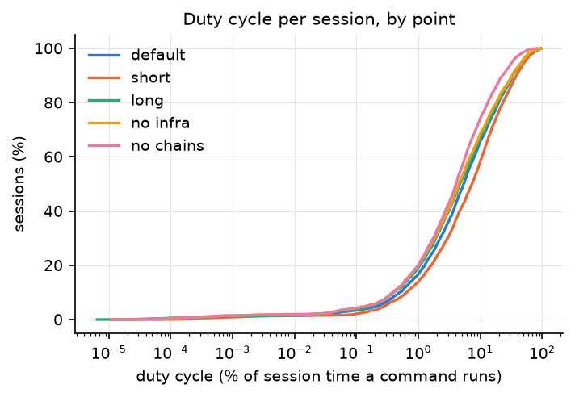

At the default point (H = 1800 s), a command is running in 9.5% of session time, and work fills
8.2% of it. Calls arrive at 0.0174 per second per session, and the mean session lasts 123 min. All
of these match SPEC §5.4 to the stated digits. Codex sessions are five times busier than Claude
sessions (19.2% against 3.8%). The no-chains point removes the busiest Codex sessions, and its
remaining Codex sessions are only 1.1% busy. That explains why no-chains has the least work of any
point (3.6% of span). Table: [sessions_summary](out/tables/sessions_summary.md).

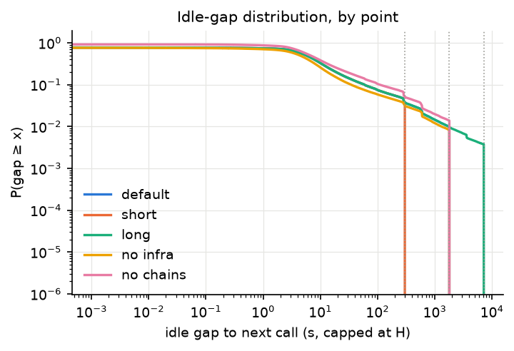

The median idle gap is 5.7 s and the p95 is 249 s at every H; the cap changes only the far tail.
The cap still matters a lot: at H = 1800 s it removes 44,268 h, which is 84% of the uncapped
session time. At H = 300 s it removes 91%. Without the cap, the replay would be almost entirely
idle.

## 2. Weight tiers and class mix

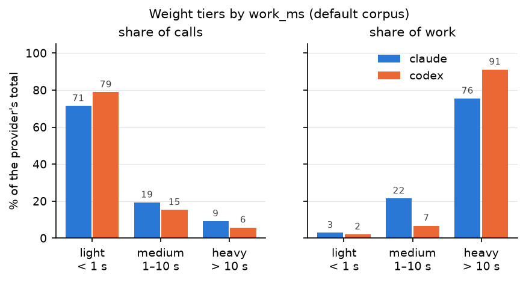

Tiers are cut on `work_ms`: light < 1 s, medium 1–10 s, heavy > 10 s. Light calls are 75% of calls
but carry only 2.4% of the work. Heavy calls are 7.4% of calls and carry 86.5% of the work. The
sensitivity cuts move that heavy work share between 79.9% (2/20 s) and 91.3% (0.5/5 s), so the
conclusion does not depend on where the cuts fall. Codex concentrates its work more than Claude
(91% against 76% heavy). Most of Codex's heavy calls (12,423 of 16,639) are polled chains.
Tables: [tiers_sensitivity](out/tables/tiers_sensitivity.md),
[tiers_by_class](out/tables/tiers_by_class.md),
[tiers_heavy_by_provider](out/tables/tiers_heavy_by_provider.md).

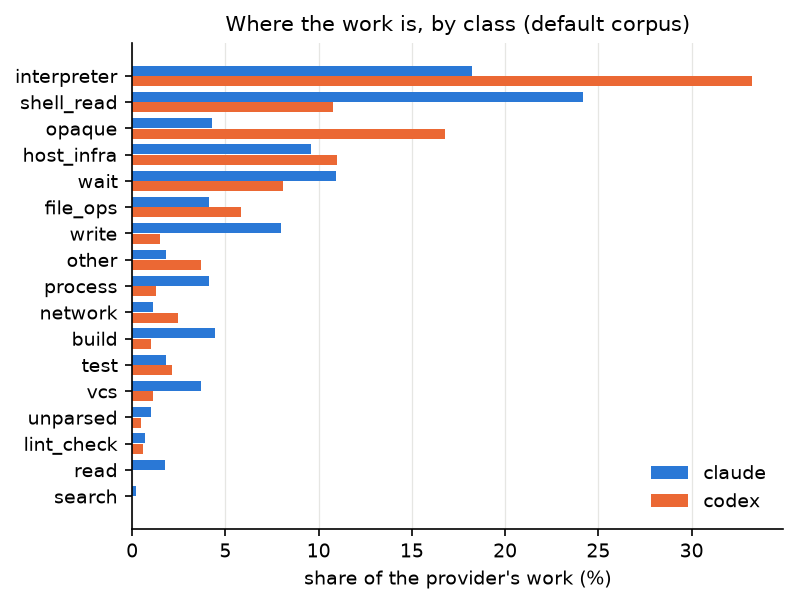

`interpreter` carries the most work for both providers (29% overall). For Claude, `shell_read`
comes next. For Codex, `opaque` comes next (a stand-in for names TraceLab withheld). `wait` is 1.1%
of calls but 8.9% of work, with a median of 30 s. That time is real `sleep` in the replay, not CPU.
Table: [class_mix_by_provider](out/tables/class_mix_by_provider.md).

## 3. How heavy calls overlap at N sessions

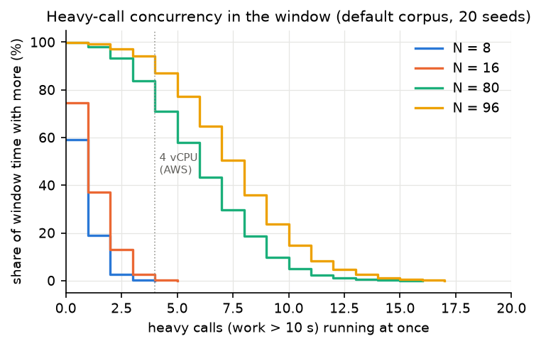

`analysis/overlap.py` replays the driver's draw. It shuffles sessions with a seed, enforces the
15% per-user cap, picks a uniform start index in [0, len − 3], spreads the slots over 60 s, and
sends calls in a closed loop with no backend delay. It then counts the heavy calls running in the
measured window, over 20 seeds. It uses Python's PRNG, not Go's, so it shows the distribution
rather than the exact sessions the driver drew. Its window call counts bracket the measured ones:
on metal at N=16 the model gives 290 calls (p10–p90: 192–374) and the rung had 286. At N=96 the
model gives 2,081 (1,758–2,498) and the rung had 1,962.

On AWS, the mean number of heavy calls running at once is 0.81 at N=8 and 1.27 at N=16. Four or
more run at once for 0.4% and 2.5% of the window. Each guest has 1 vCPU and the host has 4, so
that 2.5% is enough to queue the other calls and push the p95 past the limit. At N=80 and N=96, the
host sees 6–8 heavy calls on average and ≥ 4 for 80–94% of the window, which 96 vCPUs can absorb.
Table: [overlap_heavy](out/tables/overlap_heavy.md).

## 4. Shell calls per LLM turn (E15b input)

A turn is one `rounds.round_pk`, the unit E15b bundles. A shell call is `exec_command`, `Bash`,
`shell_command` or `shell`. `write_stdin` polls are left out. Table:
[turns_shell_calls](out/tables/turns_shell_calls.md).

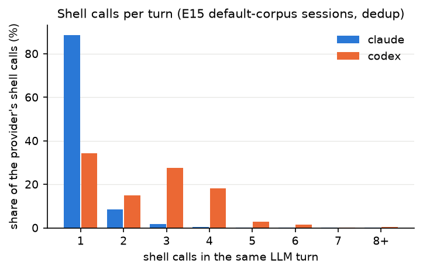

In the E15 default-corpus sessions (copied history removed), Codex sends 1.77 shell calls per turn,
and 65.7% of its shell calls sit in turns with ≥ 2. Same-turn calls almost always overlap: 99.0%
of consecutive pairs start before the previous call returns. Claude sends 1.07 per turn, 11.3% of
its shell calls share a turn, and 34% of its same-turn pairs overlap.

**Disagreement with SPEC-bundled.md §1.2.** That table gives Codex 117,638 turns and 200,521 shell
calls. Over the whole DuckDB we get 148,701 turns and 264,670 calls. For Claude it gives 62,185 and
66,983, and we get 147,767 and 158,610. We could not find a filter that gives its counts: tool
subsets, copied-history removal and session-size floors all miss them, and the branch has no script
for that table. Its shares are close to ours: calls per turn are 1.70 there and 1.78 here for
Codex, and 1.08 and 1.07 for Claude. Calls in turns with ≥ 2 are 62.7% and 65.8% for Codex, and
12.5% and 12.5% for Claude. We trust our counts, because `turns.py` rebuilds them from the hashed
DuckDB with a stated definition. The bundling conclusion (about one Exec in three removed overall,
two in five for Codex) holds under both.

## 5. Results: the latency tail

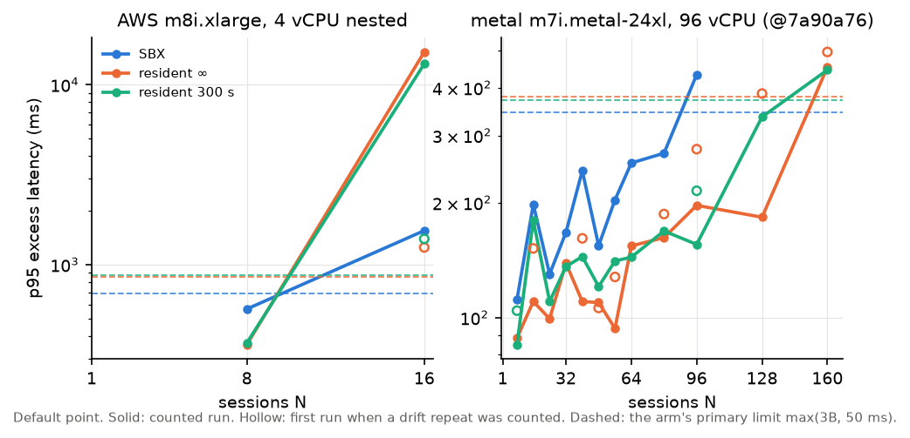

No ladder rung refused a call, and every first failed rung failed on condition 4 (the p95 of
excess latency) with 0 failed calls. On AWS, all three arms hold N=8 and fail N=16. SBX's p95
excess (1,545 ms) and resident ∞'s first run (1,246 ms) are both above their limits, and the drift
repeat pushes resident ∞ to 15,200 ms.

On metal (final @7a90a76), SBX holds every rung up to N=80. Its p95 excess rises from 111 ms (N=8)
to 270 ms (N=80), and N=96 fails at 433 ms against a 345 ms limit, with mean host CPU at 9.0%. Both
resident arms hold up to N=128 and fail at N=160: resident ∞ at 453 ms against 379 ms (the counted
drift repeat), and resident 300 s at 445 ms against 371 ms, with host CPU at 12–13%. Two resident
rungs (resident ∞ N=56 and resident 300 s N=96) first hit a rig error, where a slot ran out of
pre-created workspaces. Each was re-run with the workspace count doubled, and the re-run counts
(RESULTS-METAL.md). Tables: [rungs_all](out/tables/rungs_all.md), [ladders](out/tables/ladders.md).

These runs also have supplementary readings, which are not sealed (RESULTS-METAL.md). Under a
flat 1 s limit, every arm holds 192. Under conditions 1–3 only (no latency test), SBX holds 320,
resident ∞ 384 and resident 300 s 448. Even with the latency test removed, SBX holds the fewest
sessions. Table: [metal_supplementary](out/tables/metal_supplementary.md).

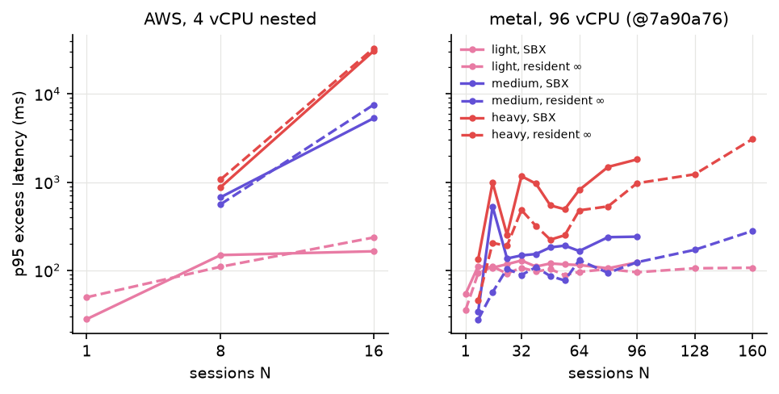

Splitting the tail by tier shows where it comes from. Light calls stay near 100–250 ms on both
hosts at every N. On AWS at N=16 the heavy tier reaches 30.7 s (SBX) and 31.9 s (resident ∞, first
run). On metal, SBX's heavy tier rises to 1.5 s at N=80 and 1.8 s at N=96, while resident ∞'s heavy
tier is 1.2 s at its last hold (N=128) and 3.1 s at N=160. At SBX N=96 the worst class is `test`,
with a p95 excess of 6.2 s. These excess figures come from `calls.jsonl` and match `record.json`'s
`p95_excess_ms` on all 152 rungs. Tables: [tail_by_tier](out/tables/tail_by_tier.md),
[tail_by_class](out/tables/tail_by_class.md).

For calls planned ≥ 1 s, SBX's p95 ratio of measured to planned time is 1.16 at N=8 and 1.97 at
N=16 on AWS. On metal it stays between 1.02 and 1.12 up to N=96. So on metal, long calls are not
stretched much. The N=96 failure is a tail of a few calls, not a general slowdown. Table:
[slowdown_ge1s](out/tables/slowdown_ge1s.md).

## 6. AWS against metal, and the N=1 overhead

At the same N, metal cuts the p95 excess by 5–140× (for example SBX N=16: 1,545 → 198 ms).
Host CPU at N=16 falls from 41–54% to under 2%. Metal limits are tighter (345–379 ms against
687–853 ms), because B is smaller there.
Table: [aws_vs_metal](out/tables/aws_vs_metal.md).

SBX's per-call overhead at N=1 is +186.2 ms on AWS and +33.7 ms on metal. That is a 5.5× drop,
in line with SPEC §4's ~4× nesting penalty. Resident arms run −16 to −28 ms (faster than the
recorded time). At mem512, SBX pays +1,589 ms on AWS and +390 ms on metal, because every scanning
call re-reads the dataset in a fresh VM. All of these agree with `EXPERIMENTS.md` §1 and
SPEC-bundled §1.1. Table: [n1_overhead](out/tables/n1_overhead.md).

## 7. Against the sealed predictions

The AWS verdicts are in `EXPERIMENTS.md` §4, and we found no number here that disagrees with them.
The metal verdicts are in RESULTS-METAL.md, against `predictions-metal.json` (sealed at `3d653a2`).
Predictions 1, 2, 3, 8 and 9 are falsified and 6 holds; 4 and 5 were not run on metal. On the
headline prediction 8, the metal ratio n_max(SBX) / n_max(resident ∞) is 80 / 128 = 0.625, below
the AWS ratio of 1.0. Our tables give the same n_max values.

## 8. E16: does SBX win when sessions are mostly idle?

**Hypothesis** (the user's, `experiments/e16-low-duty/SPEC.md` §1): when each session is busy at most 2% of the time,
SBX holds more concurrent sessions than resident VMs. The reasoning: a resident VM holds memory for
its whole session, while SBX holds a VM only while a command runs. Lower duty raises both arms'
latency limits, but leaves resident's memory per session unchanged, so at some duty cycle memory
should bind for resident before latency binds for SBX.

**Method.** E16 replays the (1%, 2%] duty band of the E15 default corpus: 456 sessions from 40
users, busy 1.49% of the time, against 9.54% for the full corpus. `analysis/e16.py` rebuilds that
band from our copy of the default corpus, and its sha256 matches the rig's corpus (`0790d748…`).
The arms are SBX and resident ∞. Physical memory is the only memory limit: moca's admission budget
is set high enough never to bind. The hypothesis holds only if SBX's n_max is at least one ladder
step above resident's. Deciding rungs run with a second seed, and a third when the first two
disagree. Table: [e16_band](out/tables/e16_band.md).

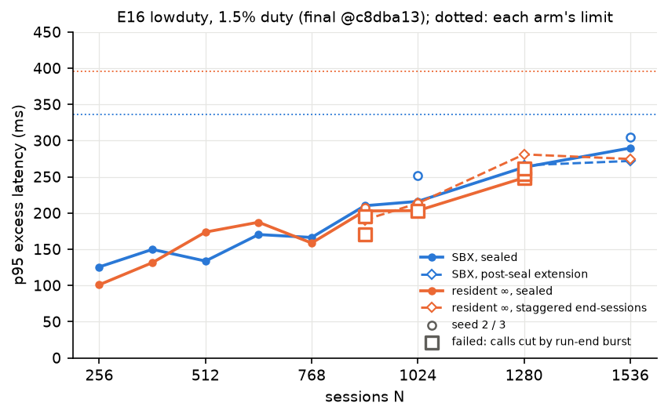

**Verdict.** The hypothesis is falsified. `experiments/e16-low-duty/RESULTS.md` reads the result three ways, and we keep
its order:

| reading | SBX n_max | resident ∞ n_max | verdict |
|---|---|---|---|
| sealed (SPEC §7.2) | ≥ 1,024 (its sealed ladder's top) | 1,024 | tie → **falsified** |
| post-seal SBX extension | ≥ 1,536 | 1,024 (sealed) | SBX ahead, **not a sealed verdict** |
| staggered end-sessions (supplementary) | ≥ 1,536 | ≥ 1,536 | **no separation** |

Neither arm failed on latency anywhere. SBX's p95 excess rises from 126 ms at N=256 to 290–305 ms at
1,536 (limit 336). Resident ∞'s rises from 101 to 275–281 ms in the staggered runs (limit 395). At
the same N the two lines cross several times (figure): the latency tail does not separate them.
Host CPU stays at or below 31% (p95) at 1,536, and no rung had a memory verdict. Every resident
failure in the sealed runs was condition 1, failed calls, and every one was the run-end burst
below. Tables: [e16_readings](out/tables/e16_readings.md), [e16_ladders](out/tables/e16_ladders.md),
[e16_rungs](out/tables/e16_rungs.md), [e16_stag](out/tables/e16_stag.md).

**What failed the resident runs: the run-end burst
([rossoctl/moca#705](https://github.com/rossoctl/moca/issues/705)).** When the 15-minute window
ends, the driver sends one end-session Exec for every live resident session at once. SBX sends
none. A moca worker connection admits 320 Execs, 256 running (`WORKER_MAX_CONCURRENT`) plus 64
queued (`QueueCap`), and refuses the rest with "busy: queue full" without logging it. On every
sealed resident rung the refused end-sessions are exactly N − 320: 64 at 384, 192 at 512, up to
576 at 896. From N ≈ 900 the refusals and the aborts they trigger overflow the connection's 16-slot
terminal-frame reserve in one second (at N=1,024: 119 end-sessions, 137 aborts and 133 VM destroys
in the same second). The worker then logs "egress wedged", drops the connection, and 9–24 calls in
flight on it fail. Excluding exactly those calls, every failed rung holds. With end-sessions
deferred past the window and paced at 50/s, every staggered rung passed three validity checks (no
wedge, no early abort, every end-session ok) and held up to 1,536. Table:
[e16_end_sessions](out/tables/e16_end_sessions.md).

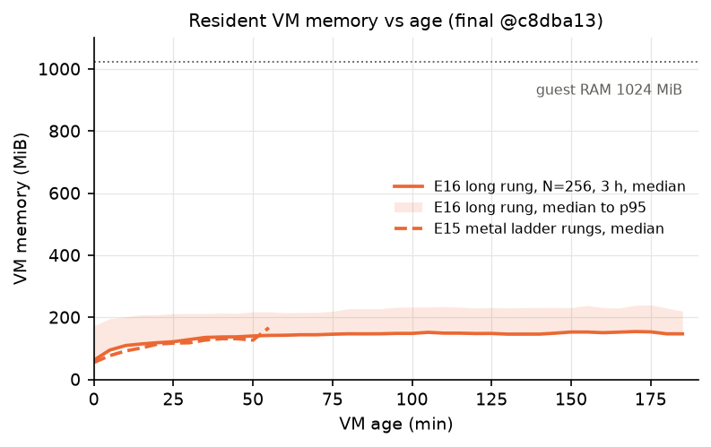

**Resident memory does not grow toward its limit.** A 3-hour resident rung at N=256 measured each
VM's memory against its age. The median VM is 62 MiB at birth, 118 MiB at 20 minutes, 142 MiB at
60 and 147–148 MiB from 2 to 3 hours. The p95 is about 230 MiB and the largest VM 309 MiB, against
1,024 MiB of guest RAM. E15's shorter metal rungs (dashed) follow the same curve.
Table: [e16_vm_age](out/tables/e16_vm_age.md).

**Against the sealed E16 predictions.** (1) The direction held (a tie falsifies the hypothesis), but
SBX's range [576, 768] was missed: SBX held at least 1,024. (2) Falsified: resident's first failure
was condition 1, not the latency tail. (3) Held: resident's VM memory at its n_max was 106 GiB, below
189 GiB, with no memory verdict (just under the claimed 109–163 GiB). (4) Held: the driver used at
most 0.10% of host CPU; control at N=768 0.005%.

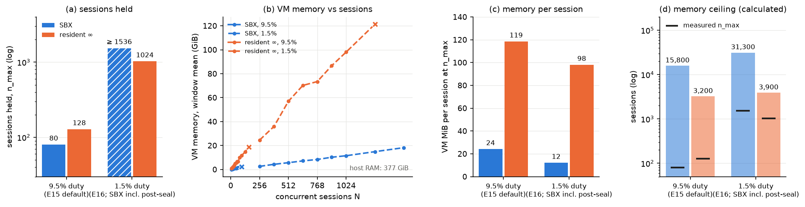

**How duty cycle moves memory and sessions.** This figure puts both experiments on the metal host
side by side, at 9.5% duty (E15) and 1.5% duty (E16). (a) Sessions held go up about tenfold for
resident ∞ (128 to 1,024, sealed) and at least nineteenfold for SBX (80 to ≥ 1,536, including the
post-seal extension); hatched means a lower bound. (b) Summed VM memory rises with N almost linearly
for resident ∞, about 0.1 GiB per session, and slowly for SBX. (c) At each arm's n_max, SBX's VMs
use 24 MiB per session at 9.5% duty and 12 MiB at 1.5%. Resident ∞ uses 119 and 98 MiB: its VMs
live for the whole session at any duty. (d) Dividing the usable 373 GiB by those rates gives a
memory ceiling near 3,900 sessions for resident ∞ and above 30,000 for SBX. Both measured n_max are
far below either ceiling: memory never bound.

**Caveats.** Both arms are censored at 1,536, so neither true ceiling is known. The band has only
456 sessions, so above N ≈ 900 each trace runs two to three times at once (distinct-trace share
0.30–0.49, below SPEC §9's 60%); those rungs are weaker evidence than the rungs at or below 1,024.
SBX's live VMs are mostly warm standbys: at N=1,024 an average of 628 VMs were alive, 612 of them
standbys and about 15 running commands. Its memory figure includes them. The ceiling in (d) is a
division, not a measurement. Tables: [duty_memory](out/tables/duty_memory.md),
[duty_memory_by_rung](out/tables/duty_memory_by_rung.md).
